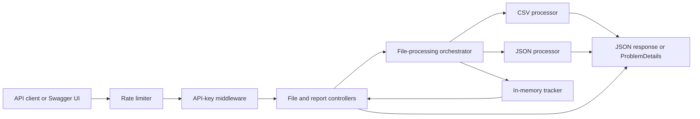
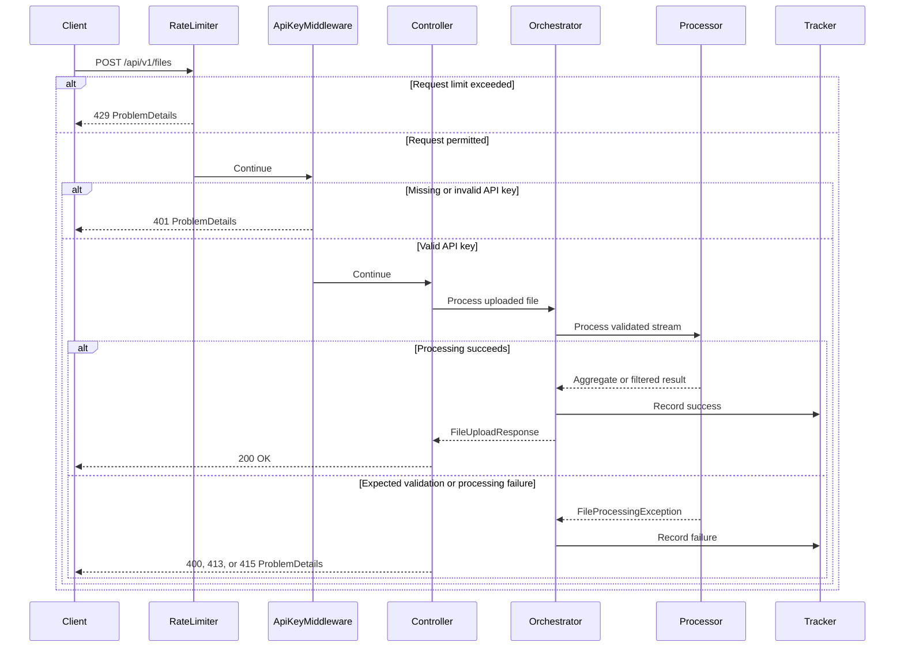

# File Processing Service

A secure RESTful web service built with ASP.NET Core 10 for uploading, validating, processing, tracking, and reporting CSV or JSON files.

The service uses API-key authentication, configurable file-processing behavior, structured error responses, rate limiting, automated tests, Swagger/OpenAPI documentation, continuous integration, and Docker containerization.

## Features

- Secure CSV and JSON upload processing through API-key authentication.
- Configurable selection of CSV support, JSON support, or both.
- CSV aggregation by calculating the average of a configured numeric column.
- JSON transformation by filtering records through independent optional conditions.
- Validation for file size, filename, extension, encoding, structure, required fields, numeric values, and record limits.
- In-memory tracking of successful and failed processing attempts.
- Processing reports containing counters and recent file details.
- Consistent RFC 7807-style `ProblemDetails` error responses.
- Per-client-IP fixed-window rate limiting.
- Structured application logging and request trace identifiers.
- Swagger/OpenAPI documentation with API-key support.
- Unit and integration tests using xUnit v3.
- Multi-stage, non-root Docker image.
- GitHub Actions validation for formatting, build, tests, dependency auditing, and Docker image creation.
- Weekly Dependabot monitoring for NuGet packages, Docker base images, and GitHub Actions.

## Default File Format

CSV processing is enabled by default, while JSON processing is disabled by default.

Select one supported format for every request. Note that the JSON processor is also implemented as an optional extension to demonstrate that another format can be enabled through configuration without changing the controller or orchestration workflow.

The supported combinations are:

| CSV | JSON | Result |
| --- | --- | --- |
| Enabled | Disabled | CSV files are accepted; JSON files return `415 Unsupported Media Type`. |
| Disabled | Enabled | JSON files are accepted; CSV files return `415 Unsupported Media Type`. |
| Enabled | Enabled | Both CSV and JSON files are accepted. |
| Disabled | Disabled | Application startup fails because at least one format must be enabled. |

## Architecture

The application is a single deployable ASP.NET Core service organized into cohesive feature and infrastructure areas. It uses dependency injection and small interfaces to keep file processors and tracking implementations loosely coupled.



### Architectural Responsibilities

| Component | Responsibility |
| --- | --- |
| Controllers | Define the versioned HTTP contract and translate expected processing failures into HTTP responses. |
| API-key middleware | Protect all routes beginning with `/api/v1/files`. |
| Rate limiter | Restrict request volume by remote IP address before processing begins. |
| Orchestrator | Validate upload metadata, select a processor, measure duration, sanitize filenames, and record outcomes. |
| CSV processor | Parse UTF-8 CSV data and calculate the configured column average. |
| JSON processor | Parse a JSON array and apply independently configurable filters. |
| Tracker | Maintain thread-safe counters and a bounded recent-processing history. |
| Options validators | Reject invalid configuration during application startup. |

## Request Flow



Uploaded files are processed during the request and are not permanently stored by the application.

## Project Structure

```text
.
|-- .github/
|   |-- workflows/
|   |   `-- ci.yml
|   `-- dependabot.yml
|-- samples/
|   |-- sample.csv
|   `-- sample.json
|-- src/
|   `-- FileProcessingService.Api/
|       |-- Configuration/
|       |-- Controllers/
|       |-- Features/
|       |   `-- Files/
|       |       |-- Contracts/
|       |       |-- Processing/
|       |       |-- Services/
|       |       `-- Tracking/
|       |-- Security/
|       |   `-- RateLimiting/
|       |-- Program.cs
|       `-- appsettings.json
|-- tests/
|   `-- FileProcessingService.Api.Tests/
|       |-- Features/
|       `-- Integration/
|-- Directory.Build.props
|-- Dockerfile
|-- docker_run.cmd
`-- FileProcessingService.slnx
```

## Configuration

The service uses standard ASP.NET Core configuration providers. Configuration can come from:

1. `appsettings.json`
2. Environment-specific settings such as `appsettings.Development.json`
3. Environment variables
4. Command-line configuration arguments

Later configuration providers override earlier providers.

Environment-variable names use double underscores in place of configuration colons. For example:

```text
ApiKeyAuthentication:ApiKey
```

becomes:

```text
ApiKeyAuthentication__ApiKey
```

### Configuration Reference

| Configuration key | Default | Valid values and behavior |
| --- | ---: | --- |
| `ApiKeyAuthentication:ApiKey` | None | Required. Must contain 32 through 128 visible ASCII characters without spaces. |
| `FileProcessing:MaximumFileSizeBytes` | `5242880` | Between 1 byte and 50 MiB. The default application limit is 5 MiB. |
| `FileProcessing:MaximumRecordCount` | `10000` | Between 1 and 100,000 records. |
| `FileProcessing:TrackingHistoryLimit` | `100` | Between 1 and 1,000 recent records. |
| `FileProcessing:CsvSupport:IsEnabled` | `true` | Enables or disables CSV processing. |
| `FileProcessing:CsvSupport:CalculateAverageInColumnName` | `Amount` | Required when CSV is enabled. Header matching is case-insensitive. |
| `FileProcessing:JsonSupport:IsEnabled` | `false` | Enables or disables JSON processing. |
| `FileProcessing:JsonSupport:FilterIsActiveEquals` | `true` | `true` returns active records, `false` returns inactive records, and `null` disables this filter. |
| `FileProcessing:JsonSupport:FilterAmountGreaterThanOrEqualTo` | `0` | Inclusive minimum amount. `null` disables the minimum filter. |
| `FileProcessing:JsonSupport:FilterAmountLessThanOrEqualTo` | `null` | Inclusive maximum amount. `null` disables the maximum filter. |
| `RateLimiting:PermitLimit` | `20` | Between 1 and 1,000 permitted requests per window and remote IP address. |
| `RateLimiting:WindowSeconds` | `60` | Between 1 and 3,600 seconds. |
| `RateLimiting:QueueLimit` | `0` | Between 0 and 1,000 queued requests. The default rejects excess requests immediately. |
| `Swagger:IsEnabled` | `true` | Enables or disables Swagger JSON and Swagger UI. |

Configuration is validated during startup. The application does not begin accepting requests if required values are missing or invalid.

Examples of rejected startup configurations include:

- A missing or malformed API key
- Both CSV and JSON support disabled
- A missing CSV average-column name while CSV is enabled
- A JSON minimum amount greater than its maximum amount
- File, record, history, or rate-limit values outside their allowed ranges

### API Key

No API key is stored in the committed configuration.

The caller or container operator supplies the key when starting the application. If running as a Docker container using the `docker_run.cmd` script and the operator did not provide the API key, it will be randomly generated by the script and you can grab it using `docker inspect` command to the container.

The key is sent through this request header:

```http
X-Api-Key: <your-api-key>
```

A missing, empty, duplicated, or incorrect API-key header returns:

```http
401 Unauthorized
WWW-Authenticate: ApiKey
Content-Type: application/problem+json
```

The application hashes the expected and provided values and compares the hashes using a fixed-time cryptographic comparison.

### CSV Configuration Example

```json
{
  "FileProcessing": {
    "CsvSupport": {
      "IsEnabled": true,
      "CalculateAverageInColumnName": "Amount"
    },
    "JsonSupport": {
      "IsEnabled": false
    }
  }
}
```

### JSON Configuration Example

The following configuration enables JSON and returns active records whose amount is between 100 and 500, inclusive:

```json
{
  "FileProcessing": {
    "CsvSupport": {
      "IsEnabled": true,
      "CalculateAverageInColumnName": "Amount"
    },
    "JsonSupport": {
      "IsEnabled": true,
      "FilterIsActiveEquals": true,
      "FilterAmountGreaterThanOrEqualTo": 100,
      "FilterAmountLessThanOrEqualTo": 500
    }
  }
}
```

Each JSON filter is independent. Setting all three filter values to `null` returns every valid input record.

## Running Locally

From the repository root, restore and build the solution:

```powershell
dotnet restore .\FileProcessingService.slnx
dotnet build .\FileProcessingService.slnx --configuration Release --no-restore
```

Set an API key in the current PowerShell session:

```powershell
$env:ApiKeyAuthentication__ApiKey = "<your-api-key>"
```

Start the HTTP development profile:

```powershell
dotnet run --project .\src\FileProcessingService.Api\FileProcessingService.Api.csproj --launch-profile http
```

The service will be available at:

```text
http://localhost:18080
```


### One-Command Configuration Alternative

ASP.NET Core command-line configuration can also supply the key for a single run:

```powershell
dotnet run --project .\src\FileProcessingService.Api\FileProcessingService.Api.csproj --launch-profile http -- --ApiKeyAuthentication:ApiKey="<your-api-key>"
```

## Swagger

Swagger UI is enabled by default at:

```text
http://localhost:18080/swagger
```

To call a protected endpoint through Swagger:

1. Open Swagger UI.
2. Select **Authorize**.
3. Enter the configured API key.
4. Select **Authorize** again.
5. Execute the desired endpoint.

Swagger sends the value through the `X-Api-Key` request header.

Swagger can be disabled without changing code:

```powershell
$env:Swagger__IsEnabled = "false"
```

## API Reference

The service exposes two operations on the same versioned resource path:

| Method | Endpoint | Purpose | Authentication |
| --- | --- | --- | --- |
| `POST` | `/api/v1/files` | Upload and process one CSV or JSON file. | Required |
| `GET` | `/api/v1/files` | Retrieve processing counters and recent file records. | Required |

Both endpoints also use the configured rate-limit policy.

### Why the Upload Uses Multipart Form Data

The upload endpoint consumes:

```http
Content-Type: multipart/form-data
```

CSV and JSON are file formats. They are not themselves multipart formats.

`multipart/form-data` is the HTTP envelope used to carry the uploaded file. Each part can include:

- A form-field name
- A filename
- A media type
- The file content

The endpoint expects exactly one form field named:

```text
File
```

Conceptually, the request looks like:

```http
POST /api/v1/files HTTP/1.1
Host: localhost:18080
X-Api-Key: <your-api-key>
Content-Type: multipart/form-data; boundary=example-boundary

--example-boundary
Content-Disposition: form-data; name="File"; filename="sample.csv"
Content-Type: text/csv

Id,Name,Amount
1,Alpha,100.00
2,Beta,200.00
3,Gamma,300.00
--example-boundary--
```

The multipart boundary separates individual request parts. API clients such as Swagger, Postman, and `curl` generate the boundary automatically.

The current endpoint processes one file per request. Processing uses asynchronous I/O, but it completes within the HTTP request rather than being placed into a background queue.

### Upload and Process a File

```http
POST /api/v1/files
```

Required headers:

```http
X-Api-Key: configured API key
Content-Type: multipart/form-data
```

Required form field:

| Name | Type | Description |
| --- | --- | --- |
| `File` | File | One CSV or JSON file. Availability depends on the enabled processors. |

The processor is selected from the sanitized filename extension. The declared per-file media type is not trusted as the only indication of the file format; the selected processor still parses and validates the content.

#### CSV Request with curl

Run this command from the repository root:

```powershell
curl.exe --silent --show-error --fail-with-body `
  --header "X-Api-Key: <your-api-key> `
  --form "File=@./samples/sample.csv;type=text/csv" `
  "http://localhost:18080/api/v1/files"
```

#### Successful CSV Response

Dynamic values such as `processingId` and processing duration will differ:

```json
{
  "processingId": "0f412fbe-7ea7-4ee3-b4c6-cdcca492dd0d",
  "fileName": "sample.csv",
  "format": "csv",
  "fileSizeBytes": 61,
  "recordsProcessed": 3,
  "processingDurationMilliseconds": 18,
  "result": {
    "columnName": "Amount",
    "average": 200.00
  }
}
```

### Retrieve the Processing Report

```http
GET /api/v1/files
```

Example:

```powershell
curl.exe --silent --show-error --fail-with-body `
  --header "X-Api-Key: <your-api-key>" `
  "http://localhost:18080/api/v1/files"
```

Example response after one successful upload:

```json
{
  "totalFilesReceived": 1,
  "totalFilesProcessedSuccessfully": 1,
  "totalFilesFailed": 0,
  "recentFiles": [
    {
      "processingId": "0f412fbe-7ea7-4ee3-b4c6-cdcca492dd0d",
      "fileName": "sample.csv",
      "format": "csv",
      "fileSizeBytes": 61,
      "status": "Succeeded",
      "recordsProcessed": 3,
      "processingDurationMilliseconds": 18,
      "completedAtUtc": "2026-07-31T07:30:00+00:00",
      "errorCode": null
    }
  ]
}
```

Recent records are returned newest first. The number retained is controlled by `FileProcessing:TrackingHistoryLimit`.

### HTTP Status Codes

| Status | Meaning |
| ---: | --- |
| `200 OK` | The file was processed successfully, or the report was returned successfully. |
| `400 Bad Request` | The request or file content failed validation. |
| `401 Unauthorized` | The API key is missing, duplicated, empty, or incorrect. |
| `413 Payload Too Large` | The uploaded file exceeds the configured application file-size limit. |
| `415 Unsupported Media Type` | The extension is unsupported or its processor is disabled. |
| `429 Too Many Requests` | The configured request limit has been exceeded for the remote IP address. |
| `500 Internal Server Error` | An unexpected unhandled failure occurred. Internal exception details are not intentionally returned. |

### ProblemDetails Errors

Expected failures use a consistent `application/problem+json` response.

Example:

```json
{
  "title": "File processing failed",
  "status": 415,
  "detail": "JSON file processing is not enabled.",
  "instance": "/api/v1/files",
  "errorCode": "json_support_disabled"
}
```

An authentication failure also includes a `traceId` that can be matched with server-side diagnostics:

```json
{
  "title": "Unauthorized",
  "status": 401,
  "detail": "A valid API key is required.",
  "errorCode": "invalid_api_key",
  "traceId": "00-234ec869347d2a7e0355e39027880c38-aca4daf01b2a2637-00"
}
```

Representative processing error codes include:

| Error code | Meaning |
| --- | --- |
| `file_name_missing` | No usable filename was supplied. |
| `file_empty` | The uploaded file contains zero bytes. |
| `file_too_large` | The configured file-size limit was exceeded. |
| `file_format_unsupported` | The filename has no supported extension. |
| `csv_support_disabled` | CSV support is disabled. |
| `json_support_disabled` | JSON support is disabled. |
| `csv_encoding_invalid` | CSV text is not valid UTF-8. |
| `csv_malformed` | The CSV structure cannot be parsed. |
| `csv_column_missing` | The configured average column does not exist. |
| `csv_column_duplicated` | More than one matching average column exists. |
| `csv_value_missing` | A record has no value in the average column. |
| `csv_value_invalid` | A value in the average column is not numeric. |
| `csv_record_limit_exceeded` | The CSV record limit was exceeded. |
| `json_malformed` | The JSON content cannot be parsed. |
| `json_record_invalid` | A JSON array item is not an object. |
| `json_is_active_missing` | An enabled active-status filter cannot find `isActive`. |
| `json_is_active_invalid` | `isActive` is not a Boolean value. |
| `json_amount_missing` | An enabled amount filter cannot find `amount`. |
| `json_amount_invalid` | `amount` is not a supported numeric value. |
| `json_record_limit_exceeded` | The JSON record limit was exceeded. |
| `rate_limit_exceeded` | The request limit was exceeded. |

## CSV Processing

CSV processing is enabled by default.

The processor:

1. Requires valid UTF-8 text.
2. Requires a header row.
3. Locates `CalculateAverageInColumnName` using case-insensitive header matching.
4. Rejects a missing or duplicated configured column.
5. Ignores blank lines.
6. Trims CSV values.
7. Requires every target-column value to be present and numeric.
8. Uses invariant-culture decimal parsing.
9. Enforces the configured record limit.
10. Calculates the arithmetic average using checked decimal arithmetic.

The included `samples/sample.csv` contains:

```csv
Id,Name,Amount
1,Alpha,100.00
2,Beta,200.00
3,Gamma,300.00
```

With the default `Amount` configuration, the result is:

```text
(100.00 + 200.00 + 300.00) / 3 = 200.00
```

## JSON Processing

JSON processing is implemented but disabled by default.

The input must be a top-level JSON array. Every array item must be a JSON object.

The processor:

1. Parses the input asynchronously.
2. Enforces the configured record limit.
3. Validates every array item as an object.
4. Applies each enabled filter independently.
5. Returns the matching records without modifying the original input fields.
6. Reports both the number of input records processed and the number matched.

### JSON Filter Semantics

| Filter | Value | Behavior |
| --- | --- | --- |
| `FilterIsActiveEquals` | `true` | Includes records whose `isActive` value is `true`. |
| `FilterIsActiveEquals` | `false` | Includes records whose `isActive` value is `false`. |
| `FilterIsActiveEquals` | `null` | Does not inspect or filter `isActive`. |
| `FilterAmountGreaterThanOrEqualTo` | Number | Includes amounts greater than or equal to the configured number. |
| `FilterAmountGreaterThanOrEqualTo` | `null` | Disables the minimum-amount filter. |
| `FilterAmountLessThanOrEqualTo` | Number | Includes amounts less than or equal to the configured number. |
| `FilterAmountLessThanOrEqualTo` | `null` | Disables the maximum-amount filter. |

When an active-status filter is enabled, each record must contain a Boolean `isActive` property.

When either amount filter is enabled, each record must contain a numeric `amount` property.

If all three filters are `null`, every valid object in the input array is returned.

### Enable JSON Locally

Set the JSON feature flag before starting the application:

```powershell
$env:FileProcessing__JsonSupport__IsEnabled = "true"
```

With the default JSON filters, active records with an amount greater than or equal to zero are returned.

### JSON Request with curl

```powershell
curl.exe --silent --show-error --fail-with-body `
  --header "X-Api-Key: <your-api-key>" `
  --form "File=@./samples/sample.json;type=application/json" `
  "http://localhost:18080/api/v1/files"
```

The included sample contains four input records. With the default filters, three active records match.

Example result section:

```json
{
  "recordsProcessed": 4,
  "result": {
    "recordsMatched": 3,
    "records": [
      {
        "id": 1,
        "name": "Active Small",
        "isActive": true,
        "amount": 50
      },
      {
        "id": 2,
        "name": "Active Medium",
        "isActive": true,
        "amount": 150
      },
      {
        "id": 4,
        "name": "Active Large",
        "isActive": true,
        "amount": 500
      }
    ]
  }
}
```

## Docker

The repository contains a multi-stage Dockerfile that:

- Restores and publishes with the .NET 10 SDK image.
- Copies only the published output into the ASP.NET Core runtime image.
- Runs in the `Production` environment.
- Listens on container port `8080`.
- Runs as the non-root user supplied by the official .NET image.
- Excludes source-control metadata, tests, samples, IDE files, build output, and local environment files from the Docker build context.

The container does not contain a committed API key. The key must be supplied at runtime.

### Build the Image Manually

From the repository root:

```powershell
docker build --file .\Dockerfile --tag file-processing-service:default .
```

### Run the Container Manually

```powershell
docker run --rm `
  --name file-processing-service `
  --publish 18080:8080 `
  --env "ApiKeyAuthentication__ApiKey=<your-api-key>" `
  file-processing-service:default
```

The API and Swagger UI will be available at:

```text
http://localhost:18080
http://localhost:18080/swagger
```

The mapping:

```text
18080:8080
```

means:

- `18080` is the port exposed on the host machine.
- `8080` is the port used by the application inside the container.

The host port can be changed without rebuilding the image:

```powershell
docker run --rm `
  --name file-processing-service `
  --publish 19090:8080 `
  --env "ApiKeyAuthentication__ApiKey=<your-api-key>" `
  file-processing-service:default
```

That container is reached through:

```text
http://localhost:19090
```

### Enable JSON in Docker

Supply the JSON feature flag as another environment variable:

```powershell
docker run --rm `
  --name file-processing-service `
  --publish 18080:8080 `
  --env "ApiKeyAuthentication__ApiKey=<your-api-key>" `
  --env "FileProcessing__JsonSupport__IsEnabled=true" `
  file-processing-service:default
```

Any non-secret application setting can be overridden using the same double-underscore environment-variable format.

Because the manual command uses `--rm`, Docker removes the stopped container automatically.

### Optional Windows Docker Launcher

The root-level `docker_run.cmd` script is an optional Windows convenience tool. Manual Docker commands remain the primary portable workflow.

Run with defaults:

```powershell
.\docker_run.cmd
```

Default values:

| Option | Default |
| --- | --- |
| Host port | `18080` |
| Container name | `file-processing-service` |
| Image repository | `file-processing-service` |
| Container tag | `default` |
| Container port | `8080` |

Supported arguments:

| Argument | Purpose |
| --- | --- |
| `--host-port VALUE` | Overrides the host port. |
| `--api-key VALUE` | Supplies a specific 32- through 128-character API key. |
| `--container-name VALUE` | Overrides the Docker container name. |
| `--container-tag VALUE` | Overrides the local image tag. |
| `--help` or `-h` | Displays usage information. |

Example with explicit values:

```powershell
.\docker_run.cmd `
  --host-port 19090 `
  --api-key "<your-api-key>" `
  --container-name file-service-demo `
  --container-tag test
```

The launcher:

1. Validates all supplied arguments.
2. Confirms that Docker and the Docker engine are available.
3. Generates a cryptographically random 32-character API key when no key is supplied.
4. Safely stops and removes an existing container only when its name and image reference both match.
5. Builds the image when the requested image does not exist locally.
6. Runs the service in the foreground.

### Retrieve an Automatically Generated API Key

When the launcher generates a key, keep the service running and open another terminal.

Retrieve the configured environment entry:

```powershell
docker inspect `
  --format "{{range .Config.Env}}{{println .}}{{end}}" `
  file-processing-service |
  Select-String "^ApiKeyAuthentication__ApiKey="
```

The output contains:

```text
ApiKeyAuthentication__ApiKey=<generated-value>
```

If a custom `--container-name` was used, replace `file-processing-service` with that name.

### Rebuild After Source Changes

The optional launcher reuses an existing image with the requested tag. After changing source code, rebuild manually:

```powershell
docker build --file .\Dockerfile --tag file-processing-service:default .
```

Alternatively, use a new tag through `--container-tag`.

### Container Storage Behavior

Uploaded files are read and processed during the request. They are not copied into a permanent application directory or Docker volume.

The processing tracker is also in memory. Its counters and recent history are lost when the process or container stops.

## Testing

The solution contains 16 automated tests using xUnit v3.

Test coverage is divided as follows:

| Area | Tests | Coverage |
| --- | ---: | --- |
| CSV processor | 3 | Successful averaging, missing configured column, and invalid numeric value |
| JSON processor | 3 | Independent filters, disabled filters, and missing required properties |
| In-memory tracker | 1 | Counters, newest-first history, and bounded retention |
| Core API integration | 3 | Missing API key, invalid API key, and successful CSV upload/reporting |
| File-validation integration | 5 | Disabled JSON, empty upload, unsupported extension, oversized file, and mixed success/failure reporting |
| Rate-limit integration | 1 | Requests beyond the configured limit return `429` |
| **Total** | **16** | Unit and full request-pipeline integration coverage |

### Run the Complete Test Suite

From the repository root:

```powershell
dotnet restore .\FileProcessingService.slnx
dotnet build .\FileProcessingService.slnx --configuration Release --no-restore
dotnet test .\FileProcessingService.slnx --configuration Release --no-build --no-restore
```

### Verify Formatting

```powershell
dotnet format .\FileProcessingService.slnx --verify-no-changes --no-restore
```

### Complete Local Quality Gate

```powershell
dotnet restore .\FileProcessingService.slnx
dotnet format .\FileProcessingService.slnx --verify-no-changes --no-restore
dotnet build .\FileProcessingService.slnx --configuration Release --no-restore
dotnet test .\FileProcessingService.slnx --configuration Release --no-build --no-restore
```

The repository applies these build-quality settings through `Directory.Build.props`:

- Latest recommended .NET analyzers
- Code-style enforcement during builds
- Warnings treated as errors
- Deterministic builds
- Continuous-integration build metadata when `CI=true`

## Continuous Integration

The GitHub Actions workflow runs for:

- Pushes to `main`
- Pull requests targeting `main`

The workflow performs:

1. Repository checkout without persisted credentials.
2. Setup of the exact .NET SDK version.
3. NuGet restore and direct/transitive vulnerability auditing.
4. Formatting verification.
5. Release build.
6. All automated tests.
7. Docker image build after the .NET quality job succeeds.

Security-related workflow settings include:

- Repository-wide `contents: read` permission
- No write permission for the workflow token
- Explicit job timeouts
- Cancellation of superseded runs
- No application API key or deployment secret
- Refreshed Docker base-image lookup during CI builds

Dependabot checks NuGet packages, Docker base images, and GitHub Actions weekly.

## Security

### Implemented Controls

| Control | Implementation |
| --- | --- |
| API-key authentication | All `/api/v1/files` routes require one valid `X-Api-Key` header. |
| Fail-fast secret validation | The application refuses to start without a valid 32- through 128-character API key. |
| Fixed-time comparison | SHA-256 hashes are compared with `CryptographicOperations.FixedTimeEquals`. |
| Secret exclusion | No runtime API key is committed to `appsettings.json`, the Dockerfile, or CI. |
| Request throttling | A fixed-window limiter restricts requests by remote IP address. |
| Upload-size limits | Application and multipart limits constrain accepted request size. |
| Record limits | CSV and JSON processors stop after the configured maximum record count. |
| Strict parsing | CSV requires valid UTF-8 and numeric decimal values; JSON requires a valid array of objects and correctly typed enabled-filter properties. |
| Filename sanitization | Directory components are stripped from submitted filenames before tracking and returning them. |
| Bounded memory use | Recent tracking history has a configurable upper bound. |
| Structured errors | Expected failures use `ProblemDetails` without intentionally exposing internal exception details. |
| Traceability | Authentication failures include a trace identifier, and processing events use structured logging. |
| Non-root container | The runtime image uses the non-root user provided by the official .NET image. |
| Build enforcement | Analyzers, warnings-as-errors, NuGet audit, automated tests, and Docker builds run in CI. |
| Dependency monitoring | Dependabot monitors NuGet packages, Docker base images, and GitHub Actions. |

### Authentication Versus Authorization

The service has one API-key access level. A valid key grants access to both upload and reporting operations.

Therefore:

- Missing or invalid credentials return `401 Unauthorized`.
- A separate `403 Forbidden` response is not used because the service does not define roles, scopes, or multiple permission levels.

### Rate Limiting

The default policy permits:

```text
20 requests per 60 seconds per remote IP address
```

The default queue limit is zero, so additional requests are rejected immediately with:

```http
429 Too Many Requests
Content-Type: application/problem+json
```

When available, the response includes a `Retry-After` header.


## Design Decisions

### Focused Single-Service Architecture

The application uses a single deployable ASP.NET Core project with cohesive feature folders.

### Pluggable File Processors

Both processors implement the same `IFileProcessor` abstraction.

The orchestrator selects a processor by file extension and does not contain CSV- or JSON-specific parsing logic. Another format can therefore be added by implementing and registering another processor instead of modifying the controller workflow.

### Configuration-Driven Format Selection

CSV and JSON availability is controlled through validated options.

This allows the application to select one format by default, enable both when appropriate, or switch processors without recompilation.

### Multipart Uploads

`multipart/form-data` is used because the endpoint accepts a file with filename and content metadata.

Using `application/json` for the complete HTTP request would be appropriate for a JSON document acting as the API request model, but it would not provide the same general file-upload contract shared by CSV and JSON.

### Request-Time Processing

Processing completes during the HTTP request. Asynchronous stream operations prevent unnecessary thread blocking, but the response is not returned until processing succeeds or fails.

This is appropriate for the configured small-file limits.

### In-Memory Tracking

A thread-safe singleton tracker provides counters and bounded recent history without requiring a database.

This satisfies the reporting requirement while clearly separating the tracking contract from its implementation, allowing a persistent implementation to replace it later.

### Built-In Trace Identifier

ASP.NET Core already creates request trace and activity identifiers. The authentication error response exposes the available identifier instead of introducing a separate custom correlation-ID format for this small service.

### No Automatic Retries

The service does not automatically retry file-processing requests.

A blind retry can process the same file more than once when the original processing succeeded but its response was lost. Reliable retries should be introduced together with idempotency rather than independently.

## Current Limitations

- Processing counters and history are stored only in memory.
- Tracking data resets whenever the application restarts.
- Each application instance has independent tracking and rate-limit state.
- Uploaded file contents are not persisted after processing.
- One file is accepted per request.
- Processing is request-based rather than queued in the background.
- Duplicate uploads are processed as separate requests.
- There is no idempotency key or content-hash deduplication.
- Interrupted uploads must be restarted from the beginning.
- Resumable or chunked uploads are not implemented.
- The fixed-window rate limiter is local to one process.
- Remote-IP rate limiting requires additional forwarded-header configuration when deployed behind trusted proxies.
- The API key represents one shared access level and has no roles or scopes.
- Changing the configured API key requires restarting the application.
- Container administrators can inspect environment variables supplied to the container.
- Swagger is enabled by default for assessment usability unless disabled through configuration.
- CSV processing assumes comma-separated, invariant-culture input.
- JSON filtering uses the fixed `isActive` and `amount` property names.
- Malware scanning and quarantine are not included.
- Archives, office documents, and password-protected files are not supported.
- The optional launcher script is Windows-specific; manual Docker commands are portable.
- Very large or malformed multipart requests may be rejected by ASP.NET Core before application-level tracking begins.

### Security Improvements

- Replace a shared API key with OAuth 2.0 or OpenID Connect when user or client identities are required.
- Introduce scopes or policies separating upload and reporting permissions.
- Load and rotate secrets through a managed secret store.
- Add malware scanning and quarantine before processing untrusted uploads.
- Add per-client quotas and audit records.
- Disable or separately protect Swagger in externally accessible environments.
